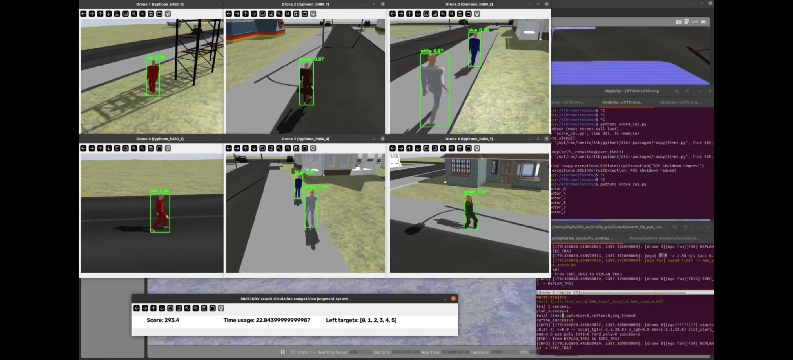
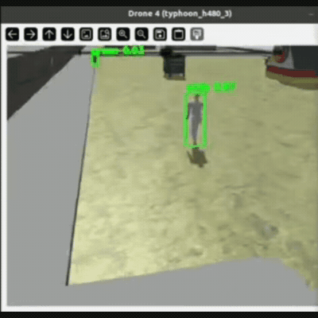
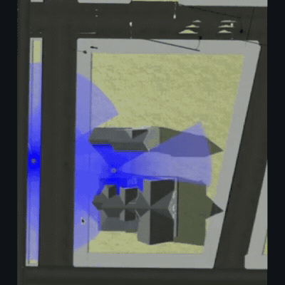
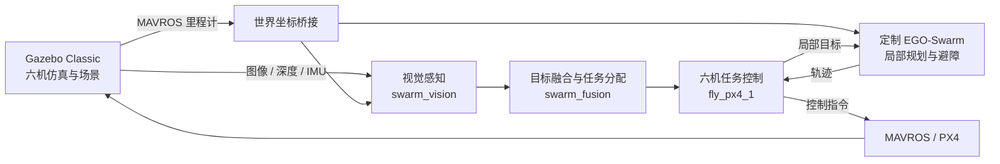

<h1 align="center">Swarm Tracking</h1>

<p align="center">
  <strong>六无人机协同视觉搜索与目标跟踪</strong><br/>
  Multi-UAV Visual Search &amp; Cooperative Target Tracking
</p>

<p align="center">
  <a href="docs/installation.md"></a>
  <a href="dependencies.repos"></a>
  <a href="docs/installation.md"></a>
  <a href="LICENSE"></a>
</p>

<p align="center">
  <a href="#演示">演示</a> ·
  <a href="#核心能力">核心能力</a> ·
  <a href="#系统架构">系统架构</a> ·
  <a href="#快速开始">快速开始</a> ·
  <a href="#文档">文档</a> ·
  <a href="README_en.md">English</a>
</p>

Swarm Tracking 将多机感知、目标融合、任务分配、局部规划与飞行控制连接成一套完整的仿真任务链路。六架无人机在预设区域内巡航，通过机载相机发现并定位行人，共享目标信息、分配跟踪任务，并在跟踪过程中执行避障与轨迹控制。

基于 **ROS Noetic、PX4 SITL、Gazebo Classic 和定制 EGO-Swarm**，适合研究与复现多无人机协同搜索、视觉定位和目标跟踪流程。

## 演示

<p align="center">
  
  <br/>
  <sub>六路机载视觉检测与任务运行画面</sub>
</p>

| 视觉检测与目标跟踪 | 多机搜索场景俯视 |
| :---: | :---: |
| [](docs/media/target-tracking.mp4?raw=1) | [](docs/media/swarm-search.mp4?raw=1) |
| [观看 / 下载完整 MP4 · 20 秒](docs/media/target-tracking.mp4?raw=1) | [观看 / 下载完整 MP4 · 20 秒](docs/media/swarm-search.mp4?raw=1) |

演示素材来自原开发环境，动图为片段预览。当前开源版本的构建、测试与复现范围见 [验证记录](docs/validation.md)；素材说明见 [媒体目录](docs/media/README.md)。

## 核心能力

| 模块 | 实现内容 |
| --- | --- |
| **协同搜索** | 六机预设航线巡航，支持三张比赛地图与七套历史路线预设。 |
| **视觉感知** | 六路图像批量 YOLO 检测，结合深度与单目几何定位，并按图像时间戳补偿相机姿态。 |
| **目标融合** | 融合多机观测、维护目标航迹，执行目标分配、共享发现与跟踪交接。 |
| **轨迹规划** | 定制 EGO-Swarm 二维局部规划，结合深度高度带感知与自主避障。 |
| **飞行控制** | 通过 MAVROS 与 PX4 连接起飞、进场、巡航、跟踪及降落状态，协调高度与偏航控制。 |
| **仿真评估** | 配套行人控制、比赛计分、离线回归测试与 ROS 控制测试。 |

## 系统架构



任务主入口 [`start_swarm.sh`](src/fly_px4/scripts/start_swarm.sh) 依次启动：

1. `swarm_relay_ego.launch`：坐标桥接、感知点云、EGO 规划与轨迹服务。
2. `swarm_track.launch`：视觉检测、目标融合、任务分配与标注窗口。
3. `swarm_fly_px4_1.launch`：六架无人机的任务控制节点。

Gazebo、行人与裁判独立启动。融合节点依据视觉和里程计维护目标航迹，具体节点职责与数据流见 [系统结构](docs/architecture.md) 和 [话题与坐标系](docs/topics_and_frames.md)。

## 快速开始

### 1. 准备环境并构建

| 组件 | 项目使用的环境 |
| --- | --- |
| 操作系统 | Ubuntu 20.04 |
| ROS / 仿真 | ROS Noetic · Gazebo Classic 11 · PX4 v1.13.2 |
| ROS Python | Python 3.8 |
| 视觉推理 | 独立 Python 3.10 环境；依赖见 [`environment.yml`](environment.yml)。 |

```bash
git clone https://github.com/xhy-yyy/swarm-tracking.git ~/swarm_tracking_ws
cd ~/swarm_tracking_ws
bash scripts/install_dependencies.sh
bash scripts/build.sh
```

运行前，请按 [安装说明](docs/installation.md) 完成 **PX4 与插件构建、模型和权重资源安装、视觉环境创建**。模型网格、纹理和检测权重通过独立资源包提供，源码仓库不包含这些大文件。

```bash
# 首次配置：在 runtime.env 中填写实际的 VISION_PYTHON 路径。
cp -n config/runtime.env.example config/runtime.env

# 安装与源码版本匹配的模型、权重资源后，校验文件完整性。
python3 scripts/check_assets.py
```

### 2. 启动仿真与任务

在三个独立终端中，从仓库根目录依次执行。以下以 `base1` 为例。

**终端 1 · 仿真环境**

```bash
bash scripts/run_simulation.sh base1
```

等待 Gazebo 场景加载完成、六机 MAVROS 连接就绪。

**终端 2 · 行人与裁判**

```bash
bash scripts/run_actors.sh both
```

裁判启动后立即开始计时，应在任务起飞前启动。

**终端 3 · 协同搜索与跟踪**

```bash
source scripts/env.sh
bash src/fly_px4/scripts/start_swarm.sh base1
```

`source scripts/env.sh` 加载本工程的 ROS、视觉解释器与资源路径。`start_swarm.sh` 统一管理三组任务启动进程，按 `Ctrl+C` 停止本脚本启动的任务进程。

[`scripts/run_mission.sh`](scripts/run_mission.sh) 是同一任务入口的封装，会先加载上述环境；需要简短命令时也可使用 `bash scripts/run_mission.sh base1`。

### 3. 选择地图与路线

| 仿真与任务参数 | 比赛场景 | 当前航线预设 |
| --- | --- | --- |
| `base1` | `base1.world` | `competition_base1.yaml` |
| `base2` | `base2.world` | `competition_base2.yaml` |
| `base3` | `base3.world` | `competition_base3.yaml` |

仿真与任务须选择同一张地图。建议始终显式传入 `base1`、`base2` 或 `base3`；`start_swarm.sh` 不传参数时会选择历史 `base0` 路线。

```bash
# 查看比赛地图与历史 route1..route7 的对应关系。
bash src/fly_px4/scripts/start_swarm.sh --list-routes

# 查看入口参数。
bash src/fly_px4/scripts/start_swarm.sh --help
```

## 关键配置

| 配置文件 | 用途 |
| --- | --- |
| [`config/runtime.env.example`](config/runtime.env.example) | 本地环境模板：视觉 Python、PX4 目录与检测权重路径。 |
| [`start_positions.yaml`](src/fly_px4/config/start_positions.yaml) | 六机起点与航线目录选择；当前启用 `patrol_maps_2`。 |
| [`patrol_maps_2/`](src/fly_px4/config/patrol_maps_2/) | 当前起点方案对应的比赛地图与历史巡航路线。 |
| [`swarm_track.launch`](src/fly_px4/launch/swarm_track.launch) | 检测阈值、同步、定位、融合与任务分配参数。 |
| [`swarm_relay_ego.launch`](src/fly_px4/launch/swarm_relay_ego.launch) | 世界坐标桥接、规划平面、感知与运动学参数。 |
| [`swarm_fly_px4_1.launch`](src/fly_px4/launch/swarm_fly_px4_1.launch) | 巡航、跟踪、高度与偏航控制参数。 |

修改起点时，需同步修改 [`six_vehicles.launch`](src/swarm_simulation/launch/six_vehicles.launch) 的 `spawn_poses` 与 `start_positions.yaml`，并选择匹配的航线目录。

## 验证

```bash
bash scripts/test.sh
```

测试入口包含离线 Python 回归与已注册的 CTest，部分控制测试使用隔离的 ROS master。已记录的构建结果、测试结果及完整六机计分飞行的复测范围见 [验证记录](docs/validation.md)。

## 文档

| 文档 | 内容 |
| --- | --- |
| [安装与运行](docs/installation.md) | 系统依赖、PX4、视觉环境、资源安装与启动。 |
| [系统结构](docs/architecture.md) | 包职责、节点关系与任务启动链路。 |
| [话题与坐标系](docs/topics_and_frames.md) | ROS 接口、消息和坐标约定。 |
| [常见问题](docs/troubleshooting.md) | 视觉环境、模型、运行库、MAVROS 与路线排查。 |
| [检测模型说明](docs/model_card.md) | 类别顺序、推理配置与模型来源信息。 |
| [控制与规划设计](src/fly_px4/docs/) | 高度控制、深度高度带避障、跟踪偏航与云台恢复。 |
| [贡献指南](CONTRIBUTING.md) | 开发约定与提交检查。 |
| [发布说明](docs/publishing.md) | 资源打包与发布流程。 |

<details>
<summary><strong>仓库目录</strong></summary>

```text
swarm-tracking/
├── src/
│   ├── fly_px4/                  任务控制、视觉、融合与启动入口
│   ├── track_msgs/               检测、航迹与跟踪消息
│   ├── ego_planner/              定制 EGO-Swarm 规划器
│   ├── gazebo_ros_actor_plugin/  行人控制插件与消息
│   ├── actor_collisions/         行人碰撞插件
│   └── swarm_simulation/         场景、模型配置与计分脚本
├── scripts/                      安装、构建、测试与仿真启动
├── config/                       环境模板与资源校验清单
├── patches/                      固定版本 PX4 / Gazebo 补丁
├── docs/                         技术文档与演示素材
├── assets/                       本地安装的模型与权重资源
└── external/                     本地获取的 PX4 源码
```

</details>

## 致谢与许可

感谢 **PX4、XTDrone、EGO-Swarm、Gazebo** 及各上游组件作者。工程来源与版本记录见 [源码快照](docs/source_snapshot.json)。

原创代码采用 [BSD-3-Clause](LICENSE) 许可；第三方组件保留各自许可证，详见 [第三方声明](THIRD_PARTY_NOTICES.md)。检测权重与训练数据的来源和许可说明见 [模型说明](docs/model_card.md)。
