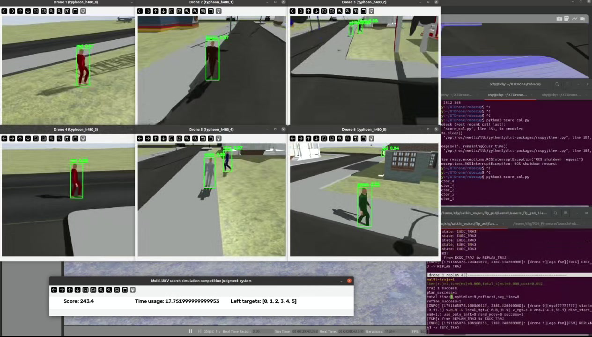
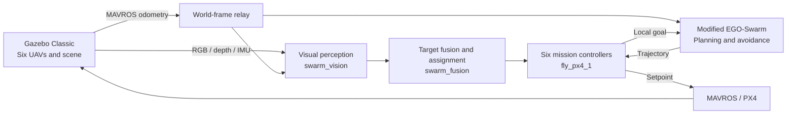

<h1 align="center">Swarm Tracking</h1>

<p align="center">
  <strong>Multi-UAV Visual Search &amp; Cooperative Target Tracking</strong><br/>
  Six UAVs · Shared target observations · Local trajectory planning
</p>

<p align="center">
  <a href="docs/installation.md"></a>
  <a href="dependencies.repos"></a>
  <a href="docs/installation.md"></a>
  <a href="LICENSE"></a>
</p>

<p align="center">
  <a href="docs/vision_environment.md"></a>
  <a href="docs/vision_environment.md"></a>
  <a href="docs/vision_environment.md"></a>
  <a href="docs/vision_environment.md"></a>
  <a href="docs/vision_environment.md"></a>
</p>

<p align="center">
  <a href="#demos">Demos</a> ·
  <a href="#capabilities">Capabilities</a> ·
  <a href="#architecture">Architecture</a> ·
  <a href="#quick-start">Quick start</a> ·
  <a href="#vision-environment">Vision environment</a> ·
  <a href="#documentation">Documentation</a> ·
  <a href="README.md">中文</a>
</p>

Swarm Tracking connects perception, target fusion, task assignment, local planning, and flight control in a six-UAV simulation workspace. UAVs patrol predefined areas, detect and localize pedestrians through onboard cameras, share target observations, and execute tracking tasks with obstacle avoidance and trajectory control.

Built on **ROS Noetic, PX4 SITL, Gazebo Classic, and a modified EGO-Swarm planner**, the project supports research and reproduction of cooperative search, visual localization, and target tracking workflows.

## Demos

<p align="center">
  
  <br/>
  <sub>Six onboard detection views during a simulation mission</sub>
</p>

| Visual detection and target tracking | Multi-UAV obstacle avoidance |
| :---: | :---: |
| [](docs/media/target-tracking.mp4) | [](docs/media/swarm-search.mp4) |
| [Download full MP4 · 20 s](https://raw.githubusercontent.com/xhy-yyy/swarm-tracking/main/docs/media/target-tracking.mp4) · [File page](docs/media/target-tracking.mp4) | [Download full MP4 · 20 s](https://raw.githubusercontent.com/xhy-yyy/swarm-tracking/main/docs/media/swarm-search.mp4) · [File page](docs/media/swarm-search.mp4) |

GIFs play inline. Download the full MP4 files for local playback, or click a preview to open its repository file page.

### Full demonstration video

A complete recording of cooperative search and target tracking, showing six onboard views and mission scoring. Duration: approximately **41 seconds**.

[](docs/media/full-demo.mp4)

[Download full demonstration MP4 · 41 s](https://raw.githubusercontent.com/xhy-yyy/swarm-tracking/main/docs/media/full-demo.mp4) · [File page](docs/media/full-demo.mp4)

These recordings show the original development environment; GIFs are short previews. See the [validation record](docs/validation.md) for the reproduction scope of the open-source workspace and the [media notes](docs/media/README.md) for asset details.

## Capabilities

| Module | Implementation |
| --- | --- |
| **Cooperative search** | Six-UAV patrol with three competition maps and seven legacy route presets. |
| **Visual perception** | Batched YOLO inference across six camera streams, depth and monocular localization, and image-time camera pose compensation. |
| **Target fusion** | Multi-UAV observation fusion, target track maintenance, task assignment, shared discoveries, and tracking handovers. |
| **Trajectory planning** | Modified EGO-Swarm 2D local planning with depth height-band sensing and obstacle avoidance. |
| **Flight control** | MAVROS/PX4 integration for takeoff, transit, patrol, tracking, and landing, with altitude and yaw control. |
| **Simulation evaluation** | Pedestrian controllers, competition scoring, offline regression tests, and ROS control tests. |

## Architecture



The mission entry point, [`start_swarm.sh`](src/fly_px4/scripts/start_swarm.sh), starts:

1. `swarm_relay_ego.launch`: world-frame relays, point clouds, EGO planning, and trajectory servers.
2. `swarm_track.launch`: detection, target fusion, assignment, and annotated views.
3. `swarm_fly_px4_1.launch`: the six UAV mission controllers.

Gazebo, pedestrians, and the judge run separately. Target fusion uses visual observations and odometry. See [architecture](docs/architecture.md) and [topics and frames](docs/topics_and_frames.md) for node responsibilities and data flow.

## Quick start

### 1. Prepare the environment and build

| Component | Project environment |
| --- | --- |
| Operating system | Ubuntu 20.04 |
| ROS / simulation | ROS Noetic · Gazebo Classic 11 · PX4 v1.13.2 |
| ROS Python | Python 3.8 |
| Vision inference | Separate Python 3.10 environment; see [`environment.yml`](environment.yml). |

```bash
git clone https://github.com/xhy-yyy/swarm-tracking.git ~/swarm_tracking_ws
cd ~/swarm_tracking_ws
bash scripts/install_dependencies.sh
bash scripts/build.sh
```

Before running, follow the [installation guide](docs/installation.md) to **build PX4 and its plugins and install model and weight assets**, then configure the [vision environment](#vision-environment) below. Meshes, textures, and detector weights are distributed separately from the source repository.

```bash
# First-time setup: set the actual VISION_PYTHON path in runtime.env.
cp -n config/runtime.env.example config/runtime.env

# Verify assets after installing the matching model and weight archives.
python3 scripts/check_assets.py
```

### 2. Start the simulation and mission

Run the following from the repository root in three separate terminals, in order. This example uses `base1`.

**Terminal 1 · Simulation**

```bash
bash scripts/run_simulation.sh base1
```

Wait for Gazebo to load and all six MAVROS connections to become ready.

**Terminal 2 · Pedestrians and judge**

```bash
bash scripts/run_actors.sh both
```

The judge starts its timer immediately. Start it before mission takeoff.

**Terminal 3 · Cooperative search and tracking**

```bash
source scripts/env.sh
bash src/fly_px4/scripts/start_swarm.sh base1
```

`scripts/env.sh` loads this workspace's ROS environment, vision interpreter, and asset paths. `start_swarm.sh` manages the three mission launch processes; `Ctrl+C` stops the mission processes it started.

[`scripts/run_mission.sh`](scripts/run_mission.sh) wraps the same entry point and loads the environment automatically. The shorter equivalent is `bash scripts/run_mission.sh base1`.

### 3. Select a map and route

| Simulation and mission argument | Competition world | Current route preset |
| --- | --- | --- |
| `base1` | `base1.world` | `competition_base1.yaml` |
| `base2` | `base2.world` | `competition_base2.yaml` |
| `base3` | `base3.world` | `competition_base3.yaml` |

Use the same map for simulation and mission. Pass `base1`, `base2`, or `base3` explicitly: without a map argument, `start_swarm.sh` selects the legacy `base0` route.

```bash
# List competition maps and legacy route1..route7 presets.
bash src/fly_px4/scripts/start_swarm.sh --list-routes

# Show entry-point arguments.
bash src/fly_px4/scripts/start_swarm.sh --help
```

## Vision environment

The project uses **system ROS Python plus a separate vision environment**. ROS builds, mission control, target fusion, and the image viewer use system Python 3.8. The `swarm_vision` detector runs with the Python 3.10 interpreter selected by `VISION_PYTHON`; ROS launch terminals do not need the vision Conda environment activated.

| Vision dependency | Recorded version | Purpose |
| --- | --- | --- |
| Python | `3.10` | Separate vision interpreter. |
| PyTorch / torchvision | `2.12.0` / `0.27.0` | YOLO inference and vision operators; use matching CUDA or CPU builds. |
| Ultralytics | `8.4.57` | Project YOLO checkpoint loading. |
| NumPy / SciPy | `2.2.6` / `1.15.3` | Image arrays, geometry, and numerical dependencies. |
| OpenCV | `4.13.0.92` | Detection annotations; pip package `opencv-python`. |
| PyYAML / rospkg | `6.0.3` / `1.6.1` | Configuration parsing and ROS Python package support. |

From the cloned repository root:

```bash
conda env create -f environment.yml
conda activate swarm-vision
python -m pip check
python -c "import sys; print(sys.executable)"
```

Set `VISION_PYTHON` in `config/runtime.env` to the **actual absolute interpreter path** printed above:

```bash
# Copy config/runtime.env.example on first use.
VISION_PYTHON="/absolute/path/to/swarm-vision/bin/python"
# Optionally set SWARM_WEIGHTS for a compatible checkpoint at another location.
```

The default checkpoint is `assets/weights/best_11s_new.pt`, distributed separately from Git. After installing the weight asset, run `python3 scripts/check_assets.py --weights-only`. See the [model card](docs/model_card.md) for the required class order.

In a **ROS terminal with Conda deactivated**, check the complete import path from the repository root:

```bash
source scripts/env.sh
"$VISION_PYTHON" -c "import torch, torchvision, ultralytics, cv2, rospy; from track_msgs.msg import DetectionArray; print('Vision imports OK'); print('CUDA:', torch.cuda.is_available(), 'runtime:', torch.version.cuda)"
```

The detector defaults to `cuda:0` with half precision. When CUDA is unavailable, it falls back to CPU and disables half precision. A compatible NVIDIA GPU is recommended for six camera streams; CPU fallback does not guarantee the configured inference rate.

Choose a CUDA build compatible with the GPU and driver. The [complete vision setup guide](docs/vision_environment.md) covers GPU/CPU wheels, ROS and `cv_bridge` separation, model inference checks, and troubleshooting (Chinese).

## Configuration

| File | Purpose |
| --- | --- |
| [`config/runtime.env.example`](config/runtime.env.example) | Local vision interpreter, PX4 directory, and detector weight paths. |
| [`start_positions.yaml`](src/fly_px4/config/start_positions.yaml) | Six UAV start positions and route directory; currently `patrol_maps_2`. |
| [`patrol_maps_2/`](src/fly_px4/config/patrol_maps_2/) | Competition and legacy routes for the current start configuration. |
| [`swarm_track.launch`](src/fly_px4/launch/swarm_track.launch) | Detection, synchronization, localization, fusion, and assignment. |
| [`swarm_relay_ego.launch`](src/fly_px4/launch/swarm_relay_ego.launch) | World-frame relays, planning plane, sensing, and kinematics. |
| [`swarm_fly_px4_1.launch`](src/fly_px4/launch/swarm_fly_px4_1.launch) | Patrol, tracking, altitude, and yaw control. |

When changing start positions, update both `spawn_poses` in [`six_vehicles.launch`](src/swarm_simulation/launch/six_vehicles.launch) and `start_positions.yaml`, then select the matching route directory.

## Validation

```bash
bash scripts/test.sh
```

This runs offline Python regressions and registered CTests; some control tests use an isolated ROS master. See the [validation record](docs/validation.md) for recorded build and test results and the scope of full six-UAV scored-flight reproduction.

## Documentation

The detailed technical guides are currently in Chinese.

| Guide | Contents |
| --- | --- |
| [Installation and operation](docs/installation.md) | Dependencies, PX4, vision environment, assets, and startup. |
| [Vision environment](docs/vision_environment.md) | Dependency versions, Conda, CUDA, interpreter configuration, weights, and inference checks. |
| [Architecture](docs/architecture.md) | Packages, nodes, and mission startup. |
| [Topics and frames](docs/topics_and_frames.md) | ROS interfaces, messages, and coordinate conventions. |
| [Troubleshooting](docs/troubleshooting.md) | Vision, models, libraries, MAVROS, and route configuration. |
| [Detector model card](docs/model_card.md) | Class order, inference configuration, and model provenance. |
| [Control and planning design](src/fly_px4/docs/) | Altitude control, depth height-band avoidance, tracking yaw, and gimbal recovery. |
| [Contributing](CONTRIBUTING.md) | Development conventions and checks. |
| [Publishing](docs/publishing.md) | Asset packaging and release preparation. |

<details>
<summary><strong>Repository layout</strong></summary>

```text
swarm-tracking/
├── src/
│   ├── fly_px4/                  Mission control, vision, fusion, and entry point
│   ├── track_msgs/               Detection and tracking messages
│   ├── ego_planner/              Modified EGO-Swarm planner
│   ├── gazebo_ros_actor_plugin/  Pedestrian plugins and messages
│   ├── actor_collisions/         Actor collision plugin
│   └── swarm_simulation/         Scenes, model configuration, and scoring
├── scripts/                      Installation, build, test, and simulation scripts
├── config/                       Environment template and asset checksums
├── patches/                      Pinned PX4 / Gazebo patches
├── docs/                         Technical guides and demo media
├── assets/                       Locally installed models and weights
└── external/                     Locally fetched PX4 sources
```

</details>

## Acknowledgments and license

Thanks to **PX4, XTDrone, EGO-Swarm, Gazebo**, and the authors of the upstream components. Source provenance and version records are available in the [source snapshot](docs/source_snapshot.json).

Original code is licensed under [BSD-3-Clause](LICENSE). Third-party components retain their respective licenses; see [third-party notices](THIRD_PARTY_NOTICES.md). See the [model card](docs/model_card.md) for weight and training-data provenance and licensing information.
