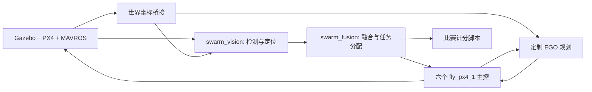

# 系统结构

## 运行链路

`scripts/run_mission.sh` 包装既有 `start_swarm.sh`，依次启动：

1. `swarm_relay_ego.launch`：六机世界坐标桥接、激光/深度高度带点云、EGO 和轨迹服务器。
2. `swarm_track.launch`：六路图像批量检测、目标融合分配和标注图窗口。
3. `swarm_fly_px4_1.launch`：六个主控节点。

仿真和计分脚本独立启动。融合节点通过检测与里程计维护目标，不订阅裁判或
Gazebo 目标真值；裁判发布通道使用 `ros_actor_cmd_pose_plugin_msgs/ActorInfo`。

## 包职责

| 包 | 职责 |
| --- | --- |
| `fly_px4` | 巡航/跟踪状态机、MAVROS 指令、视觉检测定位、融合、坐标桥接和测试 |
| `track_msgs` | 检测、目标集合、原子跟踪状态、图像时刻偏航反馈 |
| `ego_planner` 及子包 | 本项目使用的定制 EGO 规划器、环境地图和轨迹消息 |
| `ros_actor_cmd_pose_plugin` | Gazebo 行人控制插件 |
| `ros_actor_cmd_pose_plugin_msgs` | 行人与裁判通信消息 |
| `actor_collisions` | Gazebo Actor 碰撞插件；已加入 catkin 构建 |
| `swarm_simulation` | 场景、飞机/传感器配置、仿真启动和独立命名的相机 IMU 插件 |

`fly_px4_2` 和部分旧 launch 为历史探索接口，保留源码便于对照；首版主线使用
`fly_px4_1`，不需要 RACER。其他 EGO 工具包保留但不在默认构建目标内。

## 配置

- `config/start_positions.yaml`：六机起点与航线目录选择。
- `config/patrol_maps_2/competition_base*.yaml`：当前起点下的比赛地图预设。
- `config/world_frame.yaml`：本地 XY 到世界 XY 的尺度转换。
- `launch/swarm_relay_ego.launch`：规划平面、地图范围、感知和运动学参数。
- `launch/swarm_track.launch`：检测阈值、同步窗口、量测质量和分配参数。
- `launch/swarm_fly_px4_1.launch`：巡航/跟踪控制参数。

以上路径相对于 `src/fly_px4/`。这些默认值来自原工作空间，不是对其他机型
的通用标定。高度、相机安装、坐标尺度和起点须匹配仿真模型。

## 本次整理的范围

保留当前算法与任务状态机，纠正依赖声明、生成消息的构建顺序和主控安装规则；
把本机解释器/权重/模型路径改为可配置路径。PX4 本地修改以补丁保存；仿真模型
纹理与网格、检测权重单独打包。原开发工作空间不参与新工程的构建。

测试修订：`test_two_red_boxes_use_accepted_track_identity_in_both_orders`
原来假设第二个目标未分配，而当前分配器会让空闲飞机接受共享发现任务。
更新测试以验证第二架飞机处于共享接近阶段，并且不能收到第一架飞机的
图像时刻偏航反馈；没有修改融合算法。
